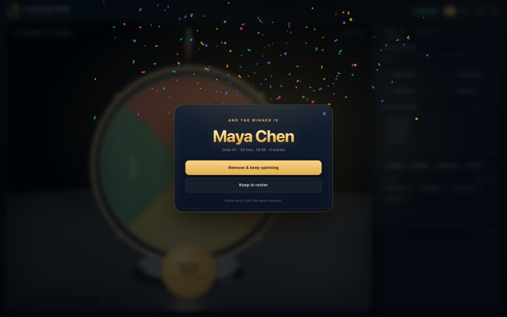
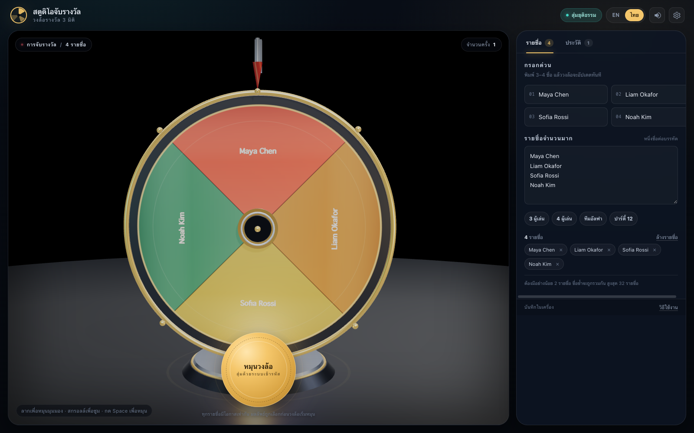

# Full 3D Lucky Draw &amp; Prize Wheel Studio

[](https://github.com/somphol/full-3d-lucky-draw-studio/actions/workflows/ci.yml)
[](https://somphol.github.io/full-3d-lucky-draw-studio/)
[](LICENSE)

A fully 3D prize wheel you can orbit, spin and trust. Type three names or paste a whole roster,
spin a fair draw chosen with the Web Crypto API, then celebrate the winner with confetti and a
synthesized fanfare. Bilingual English/ไทย, local history, JSON and CSV export — one static page,
no backend, no build step, no tracking.


## What you can do

### Spin a real wheel
- A bevel-edged 3D wheel with a gold rim, chrome pegs, a weighted stand and a spring-loaded pointer
  that kicks as every peg passes.
- Drag to orbit 360°, scroll to zoom, right-drag to pan. The camera is bounded so the wheel never
  flips under you.
- The winning slice is chosen **before** the animation starts, uniformly at random. The spin is pure
  theatre and cannot change the result.
- Cubic easing winds the wheel up, then friction brings it to rest at exactly the chosen slice.

### Add players your way
- Four quick-entry slots for the common 3–4 name draw.
- A bulk textarea for a full roster — one name per line, up to 32 entries.
- Presets for three players, four players, a five-person team and a twelve-person party.
- Every keystroke repaints the wheel texture and recalculates slice angles. Duplicates are merged
  case-insensitively and the count is shown live.



### Celebrate and record
- Winner dialog with **Remove & keep spinning** or **Keep in roster**, plus an optional
  auto-remove mode for “one prize per person” events.
- 2D particle confetti, a synthesized four-note fanfare and a pointer that settles with a spring.
- A timestamped history panel, newest first, with the spin duration and roster size.
- **Export JSON** or **Export CSV** for the complete draw log.

### Bilingual, audible, persistent
- EN ⇄ TH switches every label, empty state, toast, winner dialog and document language. Thai mode
  renders Thai throughout.
- Peg ticks rise in pitch with wheel speed; the fanfare plays only on reveal. Everything is
  synthesized with the Web Audio API — no audio files.
- Roster, history, language, sound, spin duration, full turns and auto-remove survive a reload in
  `localStorage`. There are no accounts and no network calls after the first load except the pinned
  Three.js CDN.



## Quick start

Nothing to install, nothing to build.

```bash
cd full-3d-lucky-draw-studio
python3 -m http.server 8000
# open http://localhost:8000/
```

Opening `index.html` directly works in most browsers, but ES modules and the pinned import map behave
more predictably over `http://`.

Verify the copy you are looking at:

```bash
node --test tests/engine.test.mjs tests/static.test.mjs   # engine + repository checks
node tests/browser.test.mjs                               # 18 checks in headless Chrome
```

Open [`?selftest`](https://somphol.github.io/full-3d-lucky-draw-studio/?selftest) for the built-in
18-check self-test. The result is mirrored to `document.body.dataset.selftest`.

## How the draw stays fair

For `n` entries the wheel has `n` equal slices. A slice owns `[i·2π/n, (i+1)·2π/n)` and its centre is
the landing target.

1. Pick an index uniformly with `crypto.getRandomValues` and rejection sampling — no modulo bias.
2. Compute the target wheel rotation as `π/2 + slice.mid`, plus the configured number of full turns.
3. Animate with cubic Hermite easing and stop at exactly that angle.
4. Resolve the index under the pointer and assert it equals the pick.

The browser suite and self-test both round-trip every slice index for 2–32 entries and simulate
thousands of draws. See [docs/PHYSICS.md](docs/PHYSICS.md) for the derivation.

## Architecture at a glance

Three files, no framework, no bundler:

| File | Responsibility |
| --- | --- |
| `index.html` | Shell, HUD, roster panel, history, settings drawer, winner dialog, self-test overlay, pinned import map |
| `style.css` | Design tokens, dark studio layout, responsive drawer, reduced-motion rules |
| `script.js` | Pure draw engine → i18n → platform → Three.js studio → controller → self-test |

The engine and the dictionaries are marker-delimited so Node can test them without a DOM. The wheel
face is a 2048² canvas texture; slice colours, angles and names are redrawn whenever the roster
changes. Three.js is pinned to `0.169.0` in the import map.

Read [docs/ARCHITECTURE.md](docs/ARCHITECTURE.md) for the module map and
[docs/REPRODUCTION.md](docs/REPRODUCTION.md) for a from-zero rebuild guide.

## Verification

| Gate | Command | Expected |
| --- | --- | --- |
| Engine + repo | `node --test tests/engine.test.mjs tests/static.test.mjs` | 13 + 22 checks |
| In-page | `/?selftest` | 18/18 |
| Real browser | `node tests/browser.test.mjs` | 18/18, zero console errors |
| Live copy | `TEST_URL=https://… node tests/browser.test.mjs` | 18/18 |

The browser suite launches one headless Chrome with `--use-mock-keychain` and a temporary profile, so
it never touches the macOS Keychain.

## Project docs

- [docs/README.md](docs/README.md) — documentation index
- [docs/REPRODUCTION.md](docs/REPRODUCTION.md) — rebuild this project from scratch
- [docs/ARCHITECTURE.md](docs/ARCHITECTURE.md) — engine, scene and controller contracts
- [docs/PHYSICS.md](docs/PHYSICS.md) — fairness, easing and landing math
- [docs/DESIGN.md](docs/DESIGN.md) — visual system and geometry
- [docs/TESTING.md](docs/TESTING.md) — test layers and how to extend them
- [docs/DEPLOYMENT.md](docs/DEPLOYMENT.md) — GitHub Pages and CI
- [docs/DECISIONS.md](docs/DECISIONS.md) — constraints worth preserving
- [docs/ACCESSIBILITY.md](docs/ACCESSIBILITY.md), [PERFORMANCE.md](docs/PERFORMANCE.md),
  [PRIVACY.md](docs/PRIVACY.md), [FAQ.md](docs/FAQ.md), [ROADMAP.md](docs/ROADMAP.md)

## Session record

[state.json](state.json) records the build session: elapsed wall-clock time, token usage and the
exact source line counts, captured when the release was published. The project was built in one
OpenCode session with DeepSeek V4.1 Flash.

## Credits

- Built with [OpenCode](https://opencode.ai) and **DeepSeek V4.1 Flash**.
- 3D rendering by [Three.js](https://threejs.org) `0.169.0` (MIT), including `OrbitControls` and
  `RoomEnvironment`.
- No external images, fonts, audio files or analytics. The favicon and all textures are generated.

## License

[MIT](LICENSE) © 2026 Somphol Boonjing.
